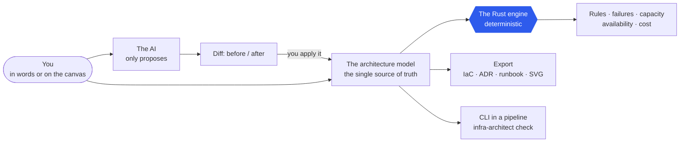

<p align="center">
  
</p>

<h3 align="center">Architecture you can break — and see what happens</h3>

<p align="center">
  Describe a system in words or build it by hand. An AI proposes a design, and a <b>deterministic engine written in Rust</b> checks it against rules, plays out failures — a node, a rack, a data center,
  a region, a cut link — works out RTO, RPO, capacity, availability and cost, and exports real IaC.
</p>

<p align="center">
  <a href="LICENSE"></a>
  <a href="https://github.com/Paffin/infraAI/commits/main"></a>
  <a href="https://github.com/Paffin/infraAI/stargazers"></a>
  
  
  
  
</p>

<p align="center">
  <a href="#quick-start"><b>Quick start</b></a> ·
  <a href="#what-it-does">What it does</a> ·
  <a href="#reference-architectures">Reference architectures</a> ·
  <a href="#checking-designs-in-ci">Checks in CI</a> ·
  <a href="#documentation">Documentation</a> ·
  <a href="README.md">Русский</a>
</p>

<p align="center">
  
  <br>
  <sub>A demo project with deliberate flaws: the engine found two risks and one question without data, and on the right — which fix pays off most, with the effect measured on a copy of the design. The interface is shown in Russian; it speaks English too.</sub>
</p>

<!-- BEGIN GENERATED: readme-numbers -->
<table align="center">
<tr>
<td align="center"><b>956</b><br><sub>products in the catalog</sub></td>
<td align="center"><b>578</b><br><sub>deployment variants</sub></td>
<td align="center"><b>60</b><br><sub>verification rules</sub></td>
<td align="center"><b>20</b><br><sub>reference architectures</sub></td>
<td align="center"><b>117</b><br><sub>settings, no rebuild</sub></td>
<td align="center"><b>1100+</b><br><sub>tests, no mocks</sub></td>
</tr>
</table>
<!-- END GENERATED: readme-numbers -->

## Why

"Three data centers, a quorum, replication, backups" looks convincing on a whiteboard. The questions come later. What happens if data center 1 disappears altogether? How much data do we lose? Will the remaining sites carry the load?
Will we meet a 99.95 % SLO? And how does what we deploy differ from what was drawn?

Infra Architect turns a diagram into a **model that can be checked**, and answers those questions with numbers instead of feelings:

* **The AI proposes — the engine proves.** The model does not decide whether a design survives. Every statement about the architecture — a finding, a recovery time, availability — is computed by a deterministic Rust engine:
  no network, no randomness, the same in the editor, in the API and in CI. Changes from the AI are applied only after you have seen the diff.
* **A failure can be played out.** Switch off a data center, a rack, a node or a link and watch the primary move, the quorum hold (or not), where the traffic goes, how many requests are lost and how much data.
* **There is no "green" without verified premises.** When the engine lacks data (a measured latency, a budget, a site tier) it does not draw "ok" — it tells you exactly what to fill in.
* **From a design to code.** Kubernetes manifests, Helm, Terraform/OpenTofu without stubs; ADR, runbook, Mermaid, SVG, JSON.
* **Yours and open.** Apache-2.0, `docker compose up`, PostgreSQL. Data goes only where you send it: to OpenRouter if you enable the AI, and to endoflife.date if you refresh the version tables.

For architects and SREs who defend a design in front of a team, and for tech leads who need an answer to "will it survive?" in a review, backed by a calculation.

## How it works



One typed model — failure zones (data center, AZ, region, rack), components, relations with meaning (dependency, replication, quorum, backup) and requirements (peak RPS, RTO, RPO, budget, SLO). The canvas, the AI,
the checks, the simulation and the export are only views of it, so they cannot drift apart.

## What it does

### Checks, not just draws

Single points of failure, quorum and arbiters, split-brain, RPO and RTO, a regional disaster, the loss of several sites, capacity under failure, backups, network, security, cost, product support dates. Every finding is
"critical", "risk" or "no data". Next to them — **"What to improve first"**: the engine tries each fix on a copy of the design, checks it again and ranks the fixes by their *measured* effect — how many critical findings
are closed, how much the score grows, what it costs.

<table>
<tr>
<td width="46%" valign="top">

</td>
<td valign="top">

A design reads like a product, not a set of rectangles: a colored icon for the kind, the product and version, a "managed service" mark, a state dot, a stack of layers where there are several instances; a zone carries its role
(active / standby / witness), its tier and the number of nodes. The "Legend" button explains lines, cards and failure particles.

For big designs — focus on the selected component, semantic zoom and a map of sites with the simulator's verdict on losing each of them.

</td>
</tr>
</table>

### Breaks it for real

An instance, a node, a cluster, a rack, a site, a link between sites, the isolation of a group of sites, a geo domain — and **several failures at once**. The simulator works out primary promotion, quorum, fencing, recovery from
backup, pilot-light scale-up and the redistribution of load; the failure panel shows recovery time, data loss, capacity and the number of affected nodes, and the recovery steps can be replayed.

A failure tells a story: first — **how the traffic flows without a failure**, then where requests are lost, which **detours** the load takes where the design has no link, and what share of requests is served in the end.

<p align="center">
  
</p>

<details>
<summary>More frames: before the failure, the moment of failure, the panel in a window, several failures at once</summary>
<br>


</details>

### Counts the nines and the money

**Expected availability**: the engine takes every failure (an instance, a whole service, a rack, a site, a link, a disaster, a provider incident), multiplies its frequency by the downtime from the simulator and compares the sum
with your SLO — and shows what the downtime is made of. **Capacity plan**: the load and headroom of each service, the worst failure, "what if the load doubles". **Cost** — by the cost models of the sites (own data center, cloud).

<table>
<tr>
<td width="50%" valign="top"></td>
<td width="50%" valign="top"></td>
</tr>
</table>

Failure frequencies and provider SLAs are assumptions, and they are configurable; the "confidence" of a score says honestly how many questions are left without data ([docs/AVAILABILITY.md](docs/AVAILABILITY.md), in Russian).

### The AI — in its place

Generating a design, editing it, "fix this finding", chat. The model's answer goes through schema checking, validation, repair and the engine's checks; what comes out is a proposal with a diff and a before/after score.
It is applied only explicitly, and the previous state is saved as a version first: any change can be rolled back. The OpenRouter key is set in the admin panel; without a key everything else works in full.

<p align="center">
  
</p>

### A catalog that knows how products fail

Hundreds of products — databases, queues, load balancers, caches, secret stores, SIEM, IT services, ERP, AI platforms — grouped by function. A product has **deployment variants** that change its failure behavior, quorum and price
(Patroni and Amazon RDS, Redis Sentinel and Cluster, Kafka on KRaft and MSK), and **versions with end-of-support dates** from [endoflife.date](https://endoflife.date): the tables are refreshed by a button, on a schedule and from CI.
The **placement wizard** builds a complete design for 1, 2, 3, 5, 10 or more sites — with racks, regions, arbiters and a standby site.

<table>
<tr>
<td valign="top"></td>
<td valign="top"></td>
</tr>
</table>

<p align="center">
  
</p>

### Real IaC and documents

Kubernetes manifests (kustomize), Helm (helmfile) and Terraform/OpenTofu are generated from templates that you edit in the admin panel, and validated against the schemas of Kubernetes, operator CRDs and providers.
"No stubs" is a principle: what cannot honestly be generated is listed in the report with the reason; secrets are never generated. Besides code — an ADR, a runbook of what to do on each failure, a Mermaid diagram, an SVG picture and JSON.

<p align="center">
  
</p>

### Everything is configurable

The admin panel manages everything without a rebuild: OpenRouter and models, limits, rules (switch on or off, change severity and weight), the product catalog and version tables, placement schemes, architecture and IaC templates,
prompts, engine parameters, users, the audit log, a backup of the configuration. There are no hard-coded numbers or texts in the code: timings, thresholds, limits, rules and the catalog are data.

<p align="center">
  
</p>

### Feels like a product

Animation in three modes (all, reduced, off; the system's preference by default), a command palette `Ctrl/⌘+K`, multi-selection and bulk actions, "Undo" after a deletion, a tour of the interface, panels that can be moved, folded
and that remember their place, Russian and English, accessibility checked by axe-core.

The full list — [docs/FEATURES.md](docs/FEATURES.md) (in Russian).

## Reference architectures

Do not start from a blank sheet: the "New project" dialog has a gallery of verified designs. The search looks at names, descriptions and tags, filter buttons narrow the choice, and a card says the size and the goals at once:
SLO, RPO, RTO. Every design passes all the rules without critical findings, holds its stated availability and its own `infra-architect check` gate, and its IaC is validated against schemas — the tests and `make iac-check`
verify it ([docs/TEMPLATES.md](docs/TEMPLATES.md), in Russian).

<p align="center">
  
</p>

<!-- BEGIN GENERATED: readme-templates -->
<details>
<summary><b>All reference architectures</b> · 20</summary>

| Architecture | Tags | SLO | RPO | RTO | Survives |
|---|---|---|---|---|---|
| **1 DC · 3 racks** | On-prem · Racks · HA | 99.9 % | 5 min | 4 h | rack failure |
| **2 DCs + witness** | DR · On-prem · Kubernetes · Kafka · HA | 99.95 % | 0 | 15 min | site failure |
| **3 AZ in one region** | Cloud · Kubernetes · Kafka · HA | 99.95 % | 0 | 5 min | site failure |
| **Multi-region, pilot light** | DR · Multi-region · Cloud · Pilot light | 99.9 % | 5 min | 1 h | disaster: loss of a region/city |
| **Event-driven on Kafka** | Kafka · Kubernetes · Cloud · HA | 99.95 % | 0 | 5 min | site failure |
| **3 sites, majority quorum** | On-prem · Quorum · Many sites | 99.95 % | 0 | 5 min | site failure |
| **5 sites, survives 2 at once** | Many sites · Quorum · DR · On-prem | 99.95 % | 0 | 5 min | site failure |
| **10 sites in 3 regions** | Many sites · Multi-region · Quorum | 99.95 % | 5 min | 1 h | disaster: loss of a region/city |
| **AWS: a web service across three zones** | Cloud · AWS · HA · Kubernetes · Managed services | 99.7 % | 0 | 5 min | site failure |
| **Azure: a web service across three zones** | Cloud · Azure · HA · Kubernetes · Managed services | 99.7 % | 0 | 5 min | site failure |
| **Google Cloud: a web service across three zones** | Cloud · Google Cloud · HA · Kubernetes · Managed services | 99.7 % | 0 | 5 min | site failure |
| **Yandex Cloud: a web service across three zones** | Cloud · Yandex Cloud · HA · Kubernetes · Managed services · Russia | 99.7 % | 0 | 5 min | site failure |
| **Kubernetes platform: GitOps and observability** | Kubernetes · Platform · GitOps · Observability · On-prem · HA | 99.95 % | 0 | 10 min | site failure |
| **Payments: 2 DCs, HSM, SIEM** | Finance · Security · DR · On-prem · HSM · Compliance | 99.95 % | 0 | 5 min | site failure |
| **Data platform: Kafka, Flink, ClickHouse** | Data · Analytics · Kafka · ClickHouse · HA | 99.9 % | 5 s | 15 min | site failure |
| **RAG assistant: LLM on GPUs and a vector database** | AI · LLM · RAG · Vector DB · GPU · HA | 99.9 % | 1 min | 10 min | site failure |
| **Serverless on AWS: API, functions, DynamoDB** | Cloud · AWS · Serverless · Managed services · Quick start | 99.5 % | 1 min | 15 min | site failure |
| **Microservices: an online shop on Kubernetes** | Microservices · Kubernetes · E-commerce · Service mesh · HA | 99.9 % | 0 | 5 min | site failure |
| **Hybrid: your own data center and a standby in the cloud** | DR · Hybrid · On-prem · Cloud · Pilot light · Cost | 99.9 % | 1 min | 4 h | site failure |
| **IoT telemetry: MQTT, EMQX and TimescaleDB** | IoT · MQTT · Time series · HA | 99.9 % | 5 s | 5 min | site failure |

</details>
<!-- END GENERATED: readme-templates -->

## Quick start

All you need is Docker (Linux, macOS, Windows through WSL):

```bash
git clone https://github.com/Paffin/infraAI.git && cd infraAI
make try    # the published image ghcr.io/paffin/infra-architect + PostgreSQL, nothing is built
# or
make up     # the same, with the image built from the source
```

Then open <http://localhost:8080> in a browser. The command writes the `.env` with the secrets (`APP_SECRET`, `POSTGRES_PASSWORD`, the password of the first administrator) itself, random and readable by you only
(`deploy/init-env.sh`; it leaves an existing `.env` alone). Without `make`: `sh deploy/init-env.sh && docker compose up -d --build`. There is no need to copy `.env.example` by hand, and it would not work: its secrets are empty and `docker compose` refuses to start.

The first administrator is created from `ADMIN_EMAIL` / `ADMIN_PASSWORD` in `.env` (`admin@example.com` and the generated password; it is needed once, at the first start). If no password is set, a random one is generated and printed **once** to the log (`docker compose logs app | grep -A3 "administrator"`) —
change it at the first sign-in. The OpenRouter key is set in **Administration → OpenRouter** (or with the `OPENROUTER_API_KEY` variable). Without a key the editor, the checks, the simulation and the export work in full —
only the AI is unavailable.

The demo project `shop-prod` is created automatically and has deliberate flaws (Redis without a replica, asynchronous queue replication, a link without a measured RTT) — you can see the checks at work on it.

Everything, tests and linters included, runs in containers — nothing needs to be installed on the host:

```bash
make test        # cargo test (engine and server against a real PostgreSQL), typecheck, vitest and the build of the frontend
make ha          # two replicas behind nginx
make smoke       # an end-to-end check of a running stack
make iac-check   # the IaC of the reference architectures against Kubernetes/CRD, Helm and Terraform schemas
```

## Checking designs in CI

A design is an artifact like code: it lives in the repository and changes with it. `infra-architect check` is the same engine as a linter for a pipeline: an exit code, thresholds, a "new findings only" baseline,
accepted risks with an expiry, reports as a job summary, GitHub annotations and SARIF for code scanning. No database, no network and no running server are needed.

```console
$ infra-architect check architecture/shop.json --recommend --lang en
shop-prod — architecture/shop.json
Score 91/100 · confidence 98% · critical 0 · risk 3 · no data 1 · Availability ≈ 99.97% (target 99.95%) · Cost 736,810 ₽ a month

RISK  Asynchronous queue replication “Kafka” → “Kafka” (lag 2 s): in-flight events may be lost on a site failure (RPO 0 s).
    DR-KFK-01 · Queue replication matches the RPO
    Where: architecture/shop.json:561  e-kafka-dc1--kafka-dc2 «Kafka → Kafka»
    Fix: Switch “Kafka” → “Kafka” to synchronous replication

What to improve first
  1. Switch “Kafka” → “Kafka” to synchronous replication  [DR-KFK-01]
     risks 3 → 2 · score 91 → 95
```

<sub>The output is shortened: the full one has two more risks and a question without data, saying what to fill in.</sub>

```yaml
# .github/workflows/architecture.yml: the verdict in the summary, annotations on the file, findings in the code scanning tab
- name: Check the designs
  run: |
    docker run --rm --user "$(id -u):$(id -g)" -v "$PWD:/work" -v "$GITHUB_STEP_SUMMARY:/summary" -w /work \
      ghcr.io/paffin/infra-architect:latest check architecture/*.json \
      --recommend --format github --report sarif=architecture.sarif --report markdown=/summary
- uses: github/codeql-action/upload-sarif@v3
  if: always() && hashFiles('architecture.sarif') != ''
  with: { sarif_file: architecture.sarif }
```

The image is published by the project's CI from the `main` branch; until it is there, build your own: `docker build -t infra-architect .`. Options, exit codes, report formats and GitLab CI examples — in [docs/CLI.md](docs/CLI.md) (in Russian).

## Under the hood

* **The engine** (`backend/crates/engine`) — Rust with no I/O: the model, the catalog, the rules, the simulator, capacity, availability, cost, export. The same code runs in the server and in the CLI.
* **The server** (`backend/crates/server`) — axum, sqlx, tokio: the HTTP API, authentication, projects and versions, the AI pipeline with jobs in the database, Prometheus metrics, the `infra-architect check` CLI.
* **The interface** (`frontend`) — Vue 3, TypeScript, Vue Flow, Pinia: the editor, the admin panel, the tests (vitest, Playwright, axe-core).
* **Data** — PostgreSQL: projects, versions, configuration (`config_items`), AI jobs, the audit log. Rules, the catalog, templates, prompts and settings are data in the database that the admin panel edits.
* **Tests without mocks** — a real PostgreSQL, a real engine, a real browser; the models' answers are recorded live runs.
* **Reliability of the service itself** — stateless replicas, graceful shutdown, Kubernetes manifests with a PDB, an HPA and zone spread ([docs/DEPLOYMENT.md](docs/DEPLOYMENT.md), in Russian).

## Limits and status

* This is not monitoring and not a control plane for live infrastructure: the engine works with the model you described or accepted from the AI.
* Scores are a model, not measurements. Failure frequencies and provider SLAs are assumptions (engine settings); the "confidence" of a score shows how much of the answer rests on your data.
* The catalog describes the typical behavior of products. If your installation differs — fix it in the admin panel; a mistake in the catalog can be corrected through an [issue or a pull request](CONTRIBUTING.md): a wrong
  statement about fault tolerance is worse than a missing product.
* Version 0.x: the core works, the data format may change between minor versions; migrations run at startup ([CHANGELOG.md](CHANGELOG.md), in Russian).

## Documentation

The documentation is written in Russian.

| Document | What it covers |
|---|---|
| [docs/FEATURES.md](docs/FEATURES.md) | all the features: what each part of the product does |
| [docs/ARCHITECTURE.md](docs/ARCHITECTURE.md) | the design of the system, the data model, flows, scaling and fault tolerance |
| [docs/CATALOG.md](docs/CATALOG.md) | the product catalog: functions, variants, versions and lifecycle, quorum and arbiters, refreshing the release tables |
| [docs/TEMPLATES.md](docs/TEMPLATES.md) | reference architectures: what each promises, how they are built, how to add your own |
| [docs/PLACEMENT.md](docs/PLACEMENT.md) | placement across sites: schemes, platforms, the generator for 1/2/3/5/10+ data centers, API, settings |
| [docs/RULES.md](docs/RULES.md) | the verification engine: statuses, the score, accepting risks, fixes, the list of rules |
| [docs/SIMULATION.md](docs/SIMULATION.md) | how the simulator computes failures, RTO, RPO, quorum, capacity, traffic |
| [docs/AVAILABILITY.md](docs/AVAILABILITY.md) | expected availability: how it is computed, what is configurable, what the estimate does not say |
| [docs/RECOMMENDATIONS.md](docs/RECOMMENDATIONS.md) | what to improve first: how fixes are tried and ranked, settings, API |
| [docs/CLI.md](docs/CLI.md) | checking designs in a pipeline: `infra-architect check`, exit codes, report formats, GitHub Actions and GitLab CI examples |
| [docs/IAC.md](docs/IAC.md) | export to Kubernetes, Helm and Terraform: how a design becomes code, what is generated and what is not |
| [docs/LLM.md](docs/LLM.md) | the OpenRouter integration, the AI pipeline, privacy and cost control |
| [docs/CONFIGURATION.md](docs/CONFIGURATION.md) | environment variables, the settings registry, configuration items, the configuration backup |
| [docs/ADMIN.md](docs/ADMIN.md) | the admin panel guide |
| [docs/API.md](docs/API.md) | the HTTP API |
| [docs/DEPLOYMENT.md](docs/DEPLOYMENT.md) | Docker, Kubernetes, HA/DR of the service itself, upgrades, observability |
| [docs/PITFALLS.md](docs/PITFALLS.md) | the pitfalls and how each of them is solved |
| [docs/DEVELOPMENT.md](docs/DEVELOPMENT.md) | development, tests, how to add a rule, a component, an architecture, a setting |
| [docs/adr](docs/adr) | architecture decisions |

> The documentation is kept together with the code: the tables of rules, settings, the catalog, versions and reference architectures, and the numbers in this file are generated from the JSON registries
> (`python3 deploy/gen-docs.py`), and CI fails when they drift from the code.

## Contributing

A bug, a wrong fact about a product, an idea or a pull request — all are welcome. Where to start, the rules of the codebase and what is checked before a merge are in [CONTRIBUTING.md](CONTRIBUTING.md) (it has an English summary);
vulnerabilities — in [SECURITY.md](SECURITY.md); by taking part you agree to the [code of conduct](CODE_OF_CONDUCT.md).

## License

Infra Architect is open source under the **[Apache License 2.0](LICENSE)**: the code can be freely used, including commercially, modified and distributed. The license contains an explicit grant of the authors' patent rights
and requires that attribution notices are kept ([NOTICE](NOTICE)). Contributions are accepted on the same terms (section 5 of the license).

The licenses of the third-party components that go into a build are listed in [THIRD_PARTY_LICENSES.md](THIRD_PARTY_LICENSES.md): the file is generated (`python3 deploy/licenses.py`), and CI rejects a dependency whose license is outside
the accepted list ([deploy/licenses.json](deploy/licenses.json)). The names of products in the catalog belong to their owners and are used only to identify them; the support dates of versions are data from [endoflife.date](https://endoflife.date).
