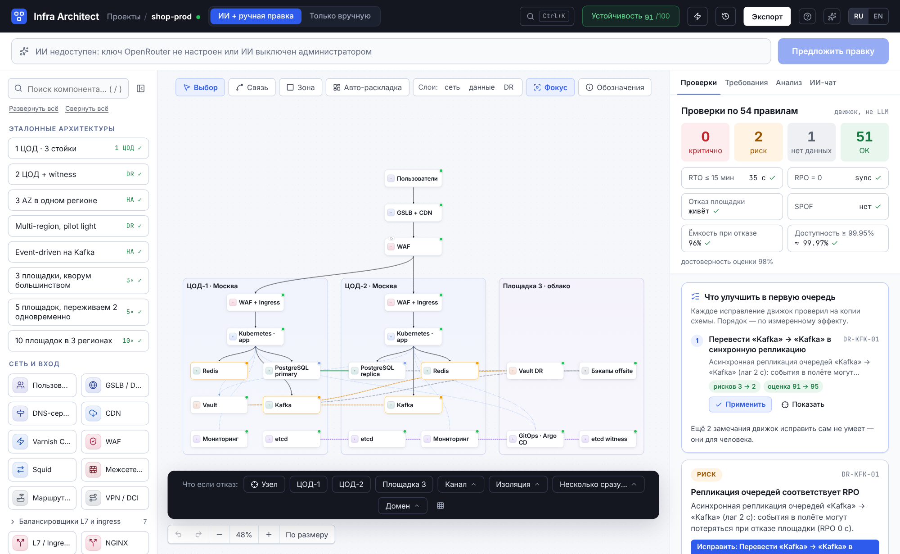
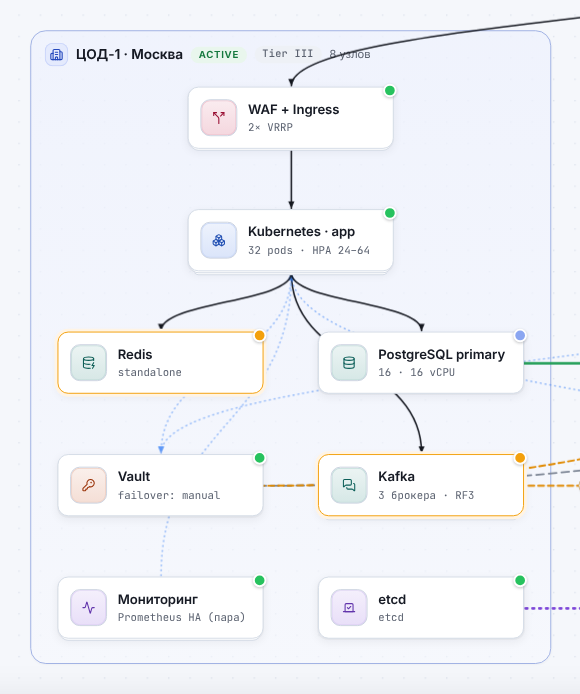
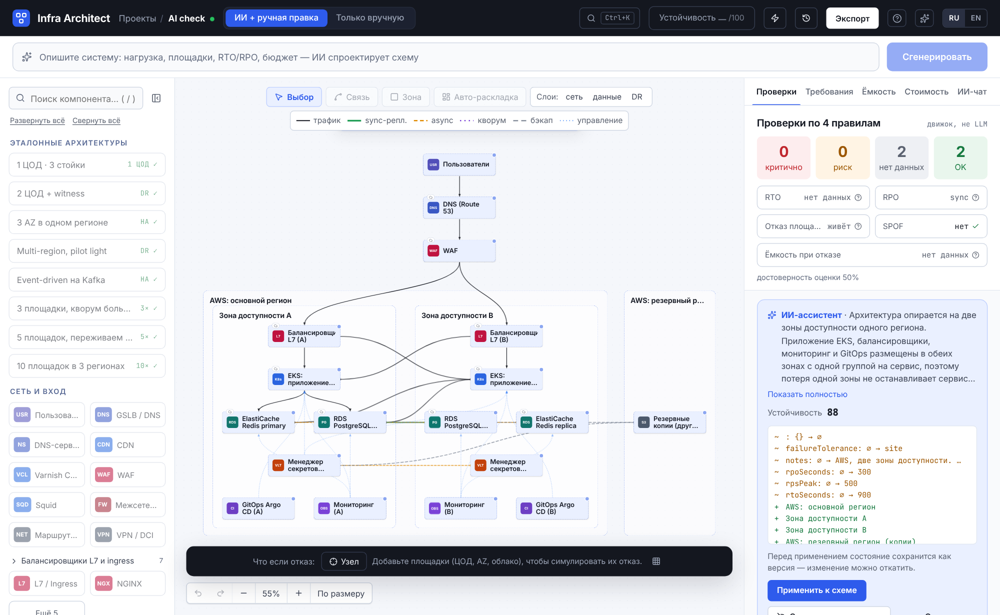
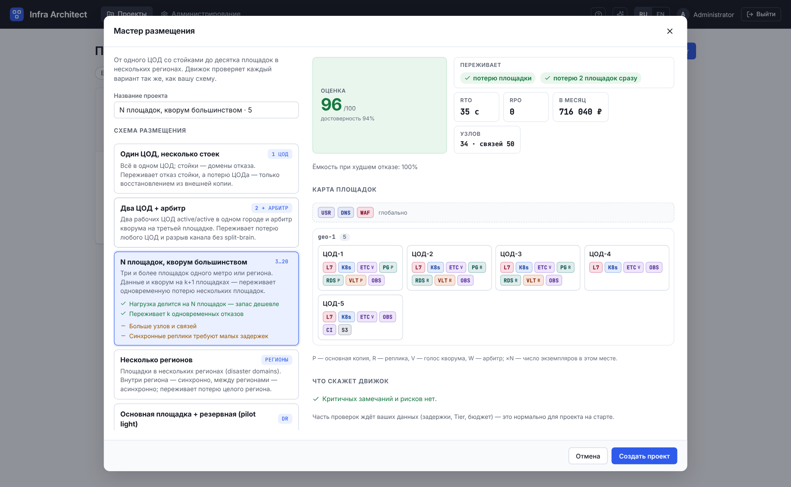
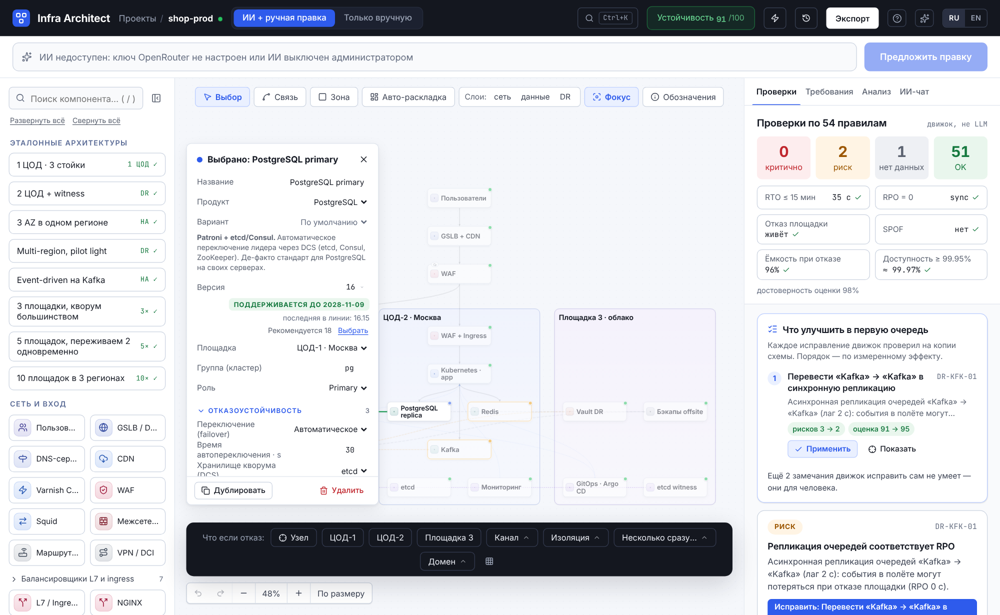
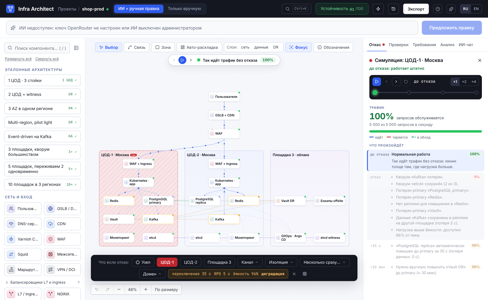
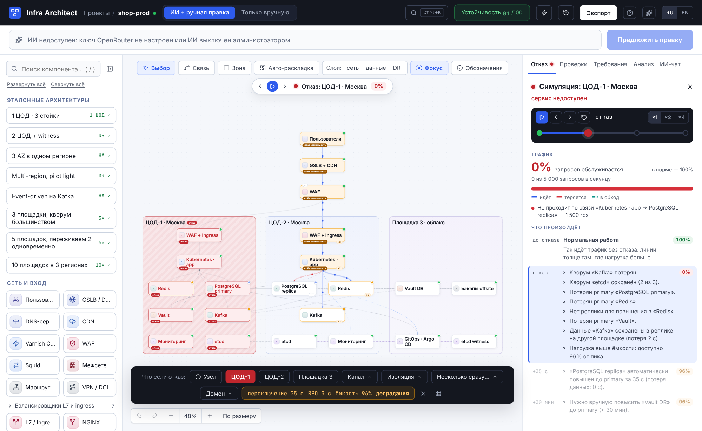
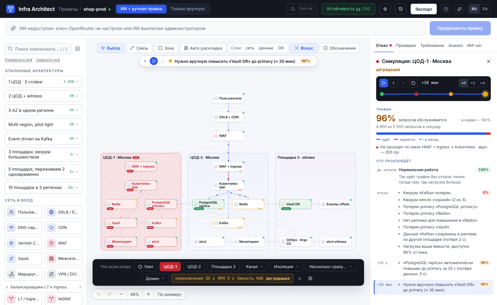
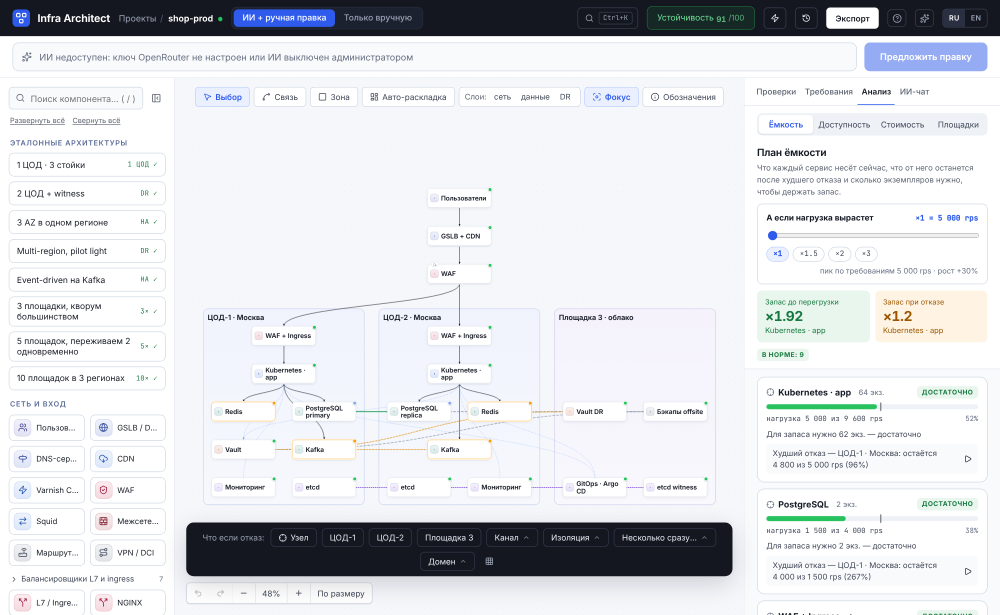

# Infra Architect

Визуальный конструктор **правильной** инфраструктурной архитектуры: вы описываете систему словами (или собираете её руками), а
детерминированный движок проверяет, переживёт ли она отказ экземпляра, площадки (ЦОД/AZ) и катастрофу в целом — и показывает *почему*.
LLM (через [OpenRouter](https://openrouter.ai)) только **предлагает**; истина — в движке, а изменения применяются после просмотра diff.



















## Что внутри

| | |
|---|---|
| **Цифровой двойник** | одна типизированная модель: зоны отказа (ЦОД/AZ/регион), компоненты, связи с семантикой (зависимость, репликация, кворум, бэкап), требования (RPS, RTO, RPO, бюджет). Холст, ИИ, проверки, симуляция и экспорт — представления этой модели |
| **Каталог продуктов** | 105 продуктов, сгруппированных по функции (БД, кэши, очереди, балансировщики, Kubernetes, секреты…), 207 вариантов развёртывания (Patroni и Amazon RDS, Redis Sentinel и Cluster, Kafka на KRaft и MSK…) и версии с датами конца поддержки из [endoflife.date](https://endoflife.date): таблицы обновляются кнопкой, по расписанию и из CI. Вариант меняет поведение при отказе, кворум, цену и свойства ([docs/CATALOG.md](docs/CATALOG.md)) |
| **Размещение** | мастер собирает полную схему для 1, 2, 3, 5, 10 и более площадок: стойки как домены отказа, регионы, арбитры для нечётного кворума, резервная площадка, `k` одновременных отказов; для каждого слоя — любой продукт и вариант; сравнение «что, если площадок больше» ([docs/PLACEMENT.md](docs/PLACEMENT.md)) |
| **Движок проверок** | 60 правил / 30 типов проверок: SPOF, кворум и witness, split-brain, RPO/RTO, гео-катастрофа, потеря нескольких площадок и стоек, ёмкость при отказе, ожидаемая доступность против SLO, бэкапы, сеть, безопасность, стоимость, сроки поддержки версий. Статусы `критично / риск / нет данных / ок` — «зелёного» без проверенных предпосылок не бывает |
| **Схемы из многих площадок** | вкладка «Анализ → Площадки»: карта площадок с вердиктом симулятора на потерю каждой; выбранный компонент подсвечивает свои связи и соседей, остальное отступает; связи между площадками при отдалении бледнеют ([docs/PLACEMENT.md](docs/PLACEMENT.md)) |
| **Подсказки, а не тупики** | у каждой находки «нет данных» — кнопки «что заполнить» (открывают нужное поле), плашки целей ведут к худшему сценарию, вкладка «Анализ» отвечает «что, если нагрузка ×2» и «сколько девяток даёт схема», палитра команд `Ctrl/⌘+K`, выделение нескольких узлов с массовыми действиями, семантический зум для больших схем, миниатюры проектов |
| **Ожидаемая доступность** | сколько времени в году сервис не работает: движок берёт каждый отказ (экземпляр, весь сервис, стойка, площадка, канал, катастрофа, инцидент провайдера), умножает частоту на простой из симулятора и сравнивает с целью. Вкладка «Анализ → Доступность» показывает, из чего складывается простой и какие отказы стоят дороже всего; частоты и SLA провайдеров — настройки и поля каталога ([docs/AVAILABILITY.md](docs/AVAILABILITY.md)) |
| **Что улучшить в первую очередь** | движок пробует каждое исправление находок на копии схемы, проверяет её заново и ставит в порядок по **измеренному** эффекту: сколько критичных закрыто, насколько выросла оценка и доступность, сколько стоит; «Применить» с отменой, «Применить всё» — набор, где каждый шаг оставлен, только если схема стала лучше ([docs/RECOMMENDATIONS.md](docs/RECOMMENDATIONS.md)) |
| **Проверка в CI** | `infra-architect check схема.json` — тот же движок как линтер для конвейера: код выхода, пороги (`--fail-on`, `--min-score`), база «только новое» (`--baseline`), принятые риски со сроком, отчёты text / Markdown (сводка задания) / аннотации GitHub / SARIF (code scanning) / JSON; конфигурация экземпляра из резервной копии. Без базы данных и сети ([docs/CLI.md](docs/CLI.md)) |
| **Симулятор отказов** | экземпляр, узел, кластер, стойка, площадка, канал между площадками, изоляция группы площадок, несколько площадок сразу, гео-домен: переключение primary, кворум, fencing, восстановление из бэкапа, масштабирование pilot-light, перераспределение нагрузки |
| **Трафик при отказе** | отказ рассказывает историю: сначала **как идёт трафик без отказа** (частицы бегут по связям, толщина — доля нагрузки, в rps, когда задан пик), затем момент отказа — где запросы теряются (красные частицы гаснут), где вызов необязательной зависимости остался без ответа, какими **объездами** нагрузка идёт там, где связи на схеме нет, — и каждый шаг восстановления. Считает движок, а не интерфейс: потоки по связям складываются в нагрузки таблицы ёмкости, «обслужено» — доля запросов, прошедших весь путь. Скорость, густота и число частиц — настройки, при сокращённых анимациях остаются толщина, цвет и числа ([docs/SIMULATION.md](docs/SIMULATION.md)) |
| **Схема читается как продукт** | карточка с цветным значком вида, продуктом и версией, меткой «управляемый сервис», точкой состояния и стопкой слоёв, если экземпляров несколько; зоны с ролью (active / standby / witness), уровнем Tier и числом узлов; подпись связи не ложится на карточку, а ждёт курсора; кнопка «Обозначения» объясняет линии каталога, карточки, зоны и частицы отказа. Значки — данные каталога: свой значок виду задаёт администратор ([docs/CATALOG.md](docs/CATALOG.md)) |
| **ИИ-проектирование** | генерация, правка, исправление замечания, чат. Ответ модели проходит схему, валидацию, ремонт, проверку движком и автоисправления; на выходе — предложение с diff и «до/после». Применяется только явно, перед этим состояние сохраняется как версия |
| **Экспорт** | настоящий IaC без заглушек — манифесты Kubernetes (kustomize), Helm (helmfile), Terraform/OpenTofu — из шаблонов, которые правятся в админ-панели, с отчётом «что не сгенерировано и почему» и проверкой по схемам CRD и провайдерам (`make iac-check`); ADR, Runbook, Mermaid, схема в SVG, JSON ([docs/IAC.md](docs/IAC.md)) |
| **Продуктовое ощущение** | анимации с тремя режимами (все / сокращённые / выключены, по умолчанию как в ОС), воспроизведение отказа по шагам восстановления, тур по интерфейсу и меню «Помощь», подсказки пустых состояний, скелетоны, «Отменить» после удаления, ход запроса к ИИ по этапам; доступность проверяется axe-core (подписи полей, заголовки и ориентиры, контраст AA), интерфейс помещается в окно от 1280 px |
| **Админ-панель** | все настройки без пересборки: OpenRouter и модели, лимиты, правила, каталог продуктов и таблицы версий, схемы и платформы размещения, шаблоны, промпты, параметры движка, пользователи, аудит, бэкап конфигурации |
| **Надёжность самого сервиса** | stateless-реплики + PostgreSQL, graceful shutdown, задачи ИИ в БД с подхватом упавших, Prometheus-метрики, Kubernetes-манифесты с PDB/HPA/spread по зонам |

Стек: **Rust** (axum, sqlx, tokio) · **Vue 3 + TypeScript** (Vue Flow, Pinia) · **PostgreSQL** · всё собирается и запускается в **Docker**.

## Быстрый старт

```bash
cp .env.example .env            # задайте APP_SECRET и POSTGRES_PASSWORD
docker compose up -d --build    # приложение + PostgreSQL
open http://localhost:8080
```

Первый администратор создаётся из `ADMIN_EMAIL` / `ADMIN_PASSWORD`; если пароль не задан, он генерируется и печатается **один раз** в лог
(`docker compose logs app | grep -A3 "administrator"`) — при первом входе его нужно сменить. Ключ OpenRouter задаётся в
**Администрирование → OpenRouter** (или переменной `OPENROUTER_API_KEY`). Без ключа редактор, проверки, симуляция и экспорт работают полностью — недоступен только ИИ.

Демо-проект `shop-prod` создаётся автоматически и содержит заведомые дефекты (Redis без реплики, асинхронная репликация очередей, канал без замера RTT) — на нём видно, как работают проверки.

Тесты и сборка без установки чего-либо на хост:

```bash
make test        # cargo test (движок + сервер на реальном PostgreSQL) и typecheck/vitest/build фронта
make ha          # две реплики за nginx
make smoke       # сквозная проверка запущенного стека
```

## Документация

| Документ | О чём |
|---|---|
| [docs/ARCHITECTURE.md](docs/ARCHITECTURE.md) | устройство системы, модель данных, потоки, масштабирование и отказоустойчивость |
| [docs/CATALOG.md](docs/CATALOG.md) | каталог продуктов: функции, варианты, версии и жизненный цикл, кворум и арбитры, обновление таблиц выпусков |
| [docs/PLACEMENT.md](docs/PLACEMENT.md) | размещение по площадкам: схемы, платформы, генератор для 1/2/3/5/10+ ЦОД, API, настройка |
| [docs/RULES.md](docs/RULES.md) | движок проверок: статусы, оценка, принятие рисков, исправления, список правил |
| [docs/SIMULATION.md](docs/SIMULATION.md) | как симулятор считает отказы, RTO, RPO, кворум, ёмкость |
| [docs/AVAILABILITY.md](docs/AVAILABILITY.md) | ожидаемая доступность: как считается, что настраивается, чего оценка не говорит |
| [docs/RECOMMENDATIONS.md](docs/RECOMMENDATIONS.md) | что улучшить в первую очередь: как исправления пробуются и ранжируются, настройки, API |
| [docs/CLI.md](docs/CLI.md) | проверка схем в конвейере: `infra-architect check`, коды выхода, форматы отчётов, примеры для GitHub Actions и GitLab CI |
| [docs/LLM.md](docs/LLM.md) | интеграция с OpenRouter, конвейер ИИ, приватность и контроль расходов |
| [docs/CONFIGURATION.md](docs/CONFIGURATION.md) | переменные окружения, реестр настроек, конфигурационные элементы, бэкап конфигурации |
| [docs/ADMIN.md](docs/ADMIN.md) | руководство по админ-панели |
| [docs/API.md](docs/API.md) | HTTP API |
| [docs/DEPLOYMENT.md](docs/DEPLOYMENT.md) | Docker, Kubernetes, HA/DR самого сервиса, обновления, наблюдаемость |
| [docs/PITFALLS.md](docs/PITFALLS.md) | подводные камни и как каждый из них решён |
| [docs/DEVELOPMENT.md](docs/DEVELOPMENT.md) | разработка, тесты, как добавить правило/компонент |
| [docs/adr](docs/adr) | архитектурные решения |

> Документация поддерживается вместе с кодом: таблицы правил, настроек, каталога и версий в `docs/RULES.md`, `docs/CONFIGURATION.md`, `docs/IAC.md` и `docs/CATALOG.md` генерируются
> из JSON-реестров (`python3 deploy/gen-docs.py`), CI падает, если они разошлись с кодом.

## Лицензия

Прототип; лицензия не выбрана.
