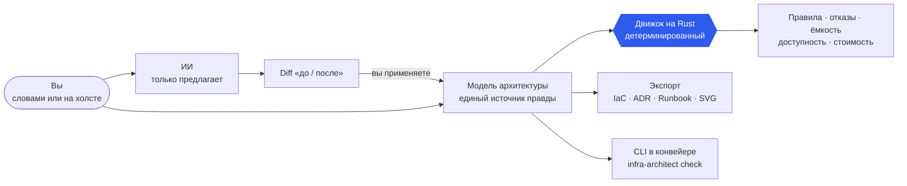
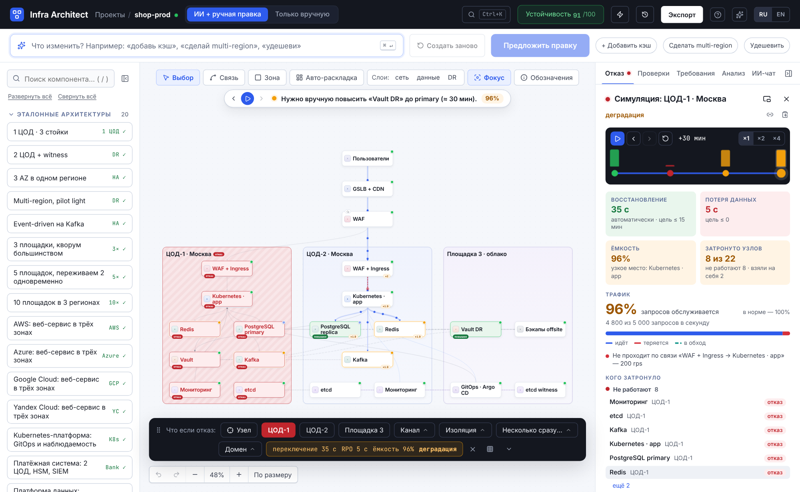
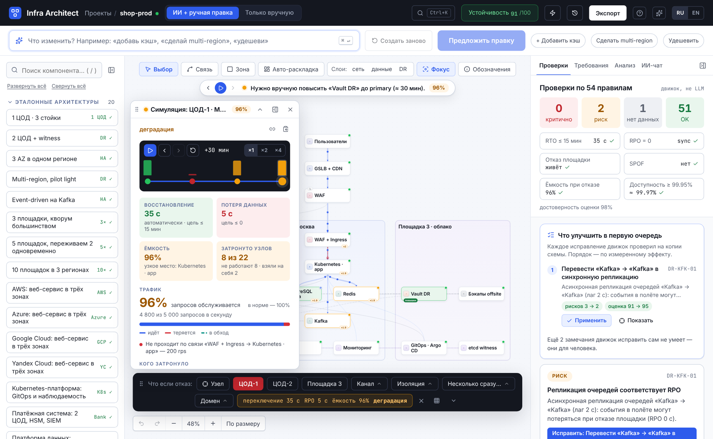
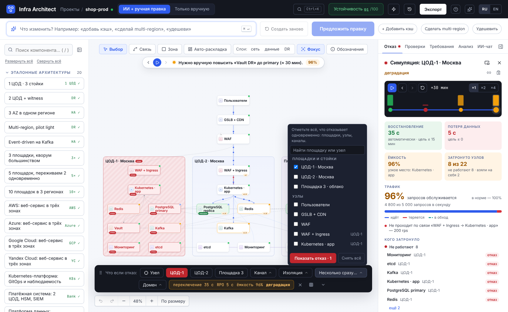
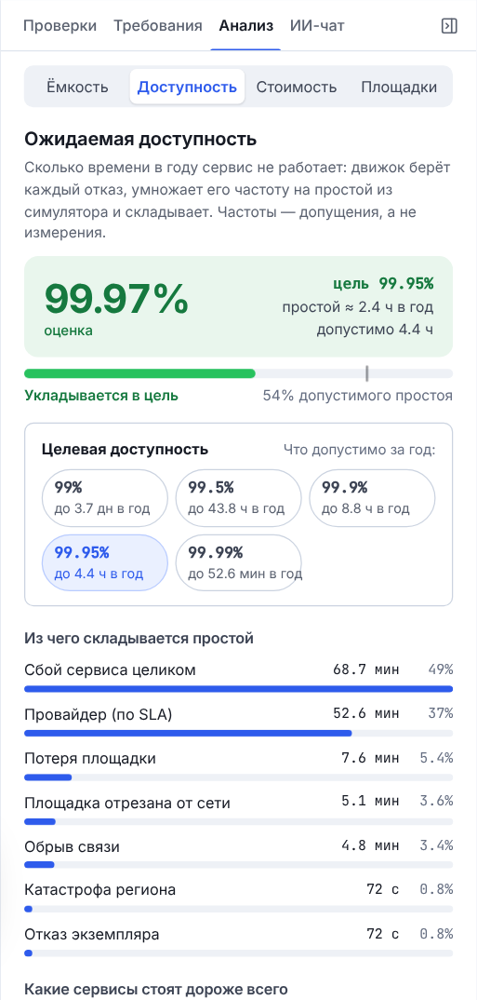
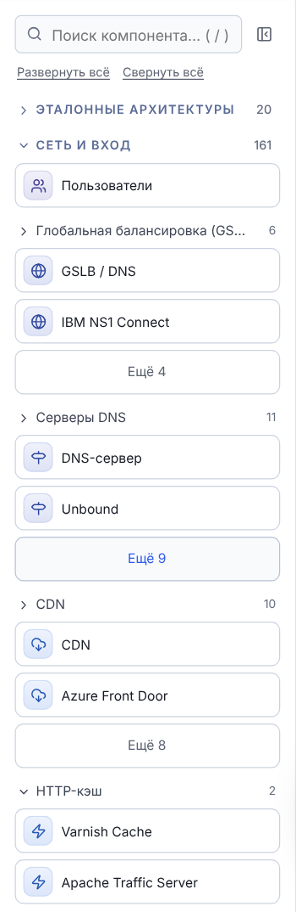
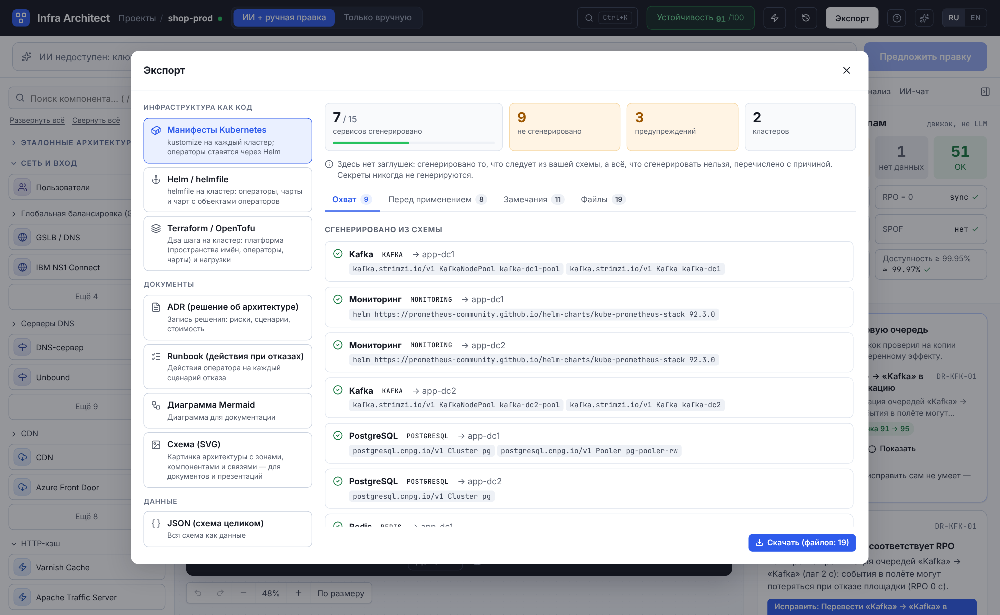
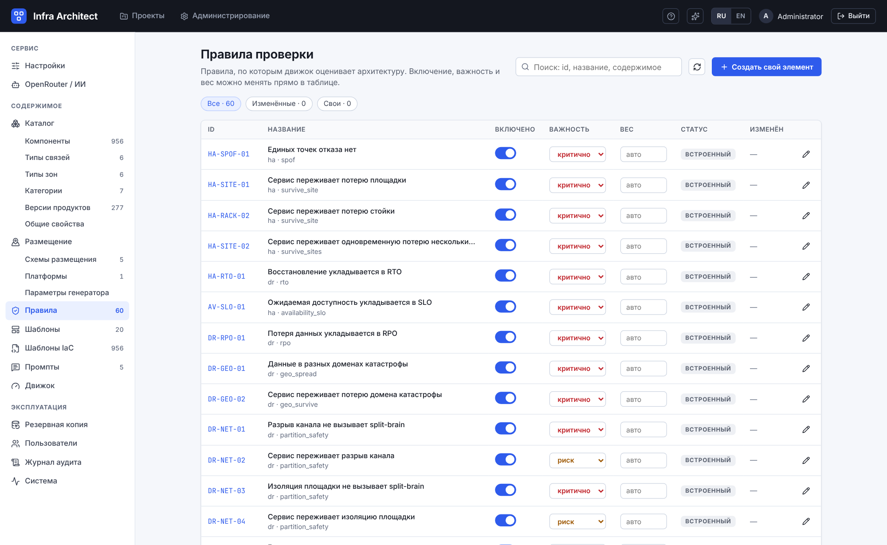
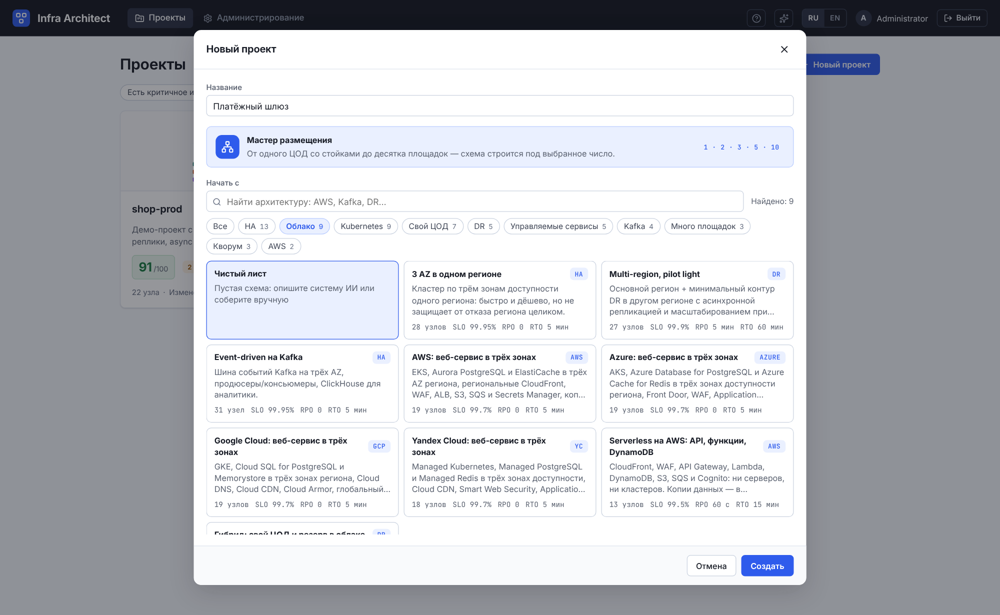

<p align="center">
  
</p>

<h3 align="center">Архитектура, которую можно сломать — и посмотреть, что будет</h3>

<p align="center">
  Опишите систему словами или соберите руками. ИИ предложит схему, а <b>детерминированный движок на Rust</b> проверит её по правилам, проиграет отказы —
  узла, стойки, ЦОДа, региона, обрыв канала, — посчитает RTO, RPO, ёмкость, доступность и стоимость и выдаст настоящий IaC.
</p>

<p align="center">
  <a href="LICENSE"></a>
  <a href="https://github.com/Paffin/infraAI/commits/main"></a>
  <a href="https://github.com/Paffin/infraAI/stargazers"></a>
  
  
  
  
</p>

<p align="center">
  <a href="#быстрый-старт"><b>Быстрый старт</b></a> ·
  <a href="#что-умеет">Что умеет</a> ·
  <a href="#эталонные-архитектуры">Эталонные архитектуры</a> ·
  <a href="#проверка-схем-в-ci">Проверка в CI</a> ·
  <a href="#документация">Документация</a> ·
  <a href="README.en.md">English</a>
</p>

<p align="center">
  
  <br>
  <sub>Демо-проект с заведомыми дефектами: движок нашёл два риска и один вопрос без данных, а справа — какое исправление даст больше всего, с эффектом, измеренным на копии схемы.</sub>
</p>

<!-- BEGIN GENERATED: readme-numbers -->
<table align="center">
<tr>
<td align="center"><b>956</b><br><sub>продуктов в каталоге</sub></td>
<td align="center"><b>578</b><br><sub>вариантов развёртывания</sub></td>
<td align="center"><b>60</b><br><sub>правил проверки</sub></td>
<td align="center"><b>20</b><br><sub>эталонных архитектур</sub></td>
<td align="center"><b>113</b><br><sub>настроек без пересборки</sub></td>
<td align="center"><b>900+</b><br><sub>автотестов без моков</sub></td>
</tr>
</table>
<!-- END GENERATED: readme-numbers -->

## Зачем

«Три ЦОДа, кворум, репликация, бэкапы» на доске выглядит убедительно. Вопросы начинаются потом. Что будет, если ЦОД-1 пропадёт целиком? Сколько данных потеряем? Выдержат ли оставшиеся площадки нагрузку?
Уложимся ли в SLO 99.95 %? И чем то, что мы развернём, отличается от того, что нарисовано?

Infra Architect превращает схему в **проверяемую модель** и отвечает на эти вопросы числами, а не ощущениями:

* **ИИ предлагает — движок доказывает.** Модель не решает, выживет ли схема. Каждый факт об архитектуре — находка, время восстановления, доступность — считает детерминированный Rust-движок: без сети, без случайности,
  одинаково в редакторе, в API и в CI. Правки от ИИ применяются только после просмотра diff.
* **Отказ можно проиграть.** Выключите ЦОД, стойку, узел или канал — и вы увидите, как переключается primary, держится ли кворум, куда уходит трафик, сколько запросов теряется и сколько данных.
* **«Зелёного» без проверенных предпосылок не бывает.** Если движку не хватает данных (замера задержки, бюджета, уровня площадки), он не рисует «ок», а говорит, что именно заполнить.
* **От схемы — к коду.** Манифесты Kubernetes, Helm, Terraform/OpenTofu без заглушек; ADR, Runbook, Mermaid, SVG, JSON.
* **Свой и открытый.** Лицензия Apache-2.0, `docker compose up`, PostgreSQL. Данные уходят только туда, куда вы сами направили их: в OpenRouter, если включили ИИ, и на endoflife.date, если обновляете таблицы версий.

Инструмент для архитекторов и SRE, которые защищают схему перед командой, и для техлидов, которым в ревью нужен ответ «а переживёт ли?», подтверждённый расчётом.

## Как это работает



Единая типизированная модель — зоны отказа (ЦОД, AZ, регион, стойка), компоненты, связи с семантикой (зависимость, репликация, кворум, резервная копия) и требования (пик RPS, RTO, RPO, бюджет, SLO). Холст, ИИ,
проверки, симуляция и экспорт — лишь её представления, поэтому они не могут разойтись друг с другом.

## Что умеет

### Проверяет, а не рисует

Единые точки отказа, кворум и арбитры, split-brain, RPO и RTO, катастрофа региона, потеря нескольких площадок, ёмкость при отказе, бэкапы, сеть, безопасность, стоимость, сроки поддержки версий. Каждая находка —
«критично», «риск» или «нет данных». Рядом — **«Что улучшить в первую очередь»**: движок пробует каждое исправление на копии схемы, проверяет её заново и ставит исправления в порядок по *измеренному* эффекту — сколько
критичных закрыто, насколько выросла оценка, сколько это стоит.

<table>
<tr>
<td width="46%" valign="top">

</td>
<td valign="top">

Схема читается как продукт, а не как набор прямоугольников: цветной значок вида, продукт и версия, метка «управляемый сервис», точка состояния, стопка слоёв там, где экземпляров несколько; у зоны — роль
(active / standby / witness), уровень Tier и число узлов. Кнопка «Обозначения» объясняет линии, карточки и частицы отказа.

Для больших схем — фокус на выбранном компоненте, семантический зум и карта площадок с вердиктом симулятора на потерю каждой.

</td>
</tr>
</table>

### Ломает по-настоящему

Экземпляр, узел, кластер, стойка, площадка, канал между площадками, изоляция группы площадок, гео-домен — и **несколько отказов сразу**. Симулятор считает переключение primary, кворум, fencing, восстановление из
бэкапа, масштабирование pilot-light и перераспределение нагрузки; панель отказа показывает время восстановления, потерю данных, ёмкость и число затронутых узлов, а шаги восстановления можно проиграть.

Отказ рассказывает историю: сначала — **как идёт трафик без отказа**, затем — где запросы теряются, какими **объездами** нагрузка идёт там, где связи на схеме нет, и какая доля запросов в итоге обслуживается.

<p align="center">
  
</p>

<details>
<summary>Ещё кадры: до отказа, момент отказа, панель в окне, несколько отказов сразу</summary>
<br>








</details>

### Считает девятки и деньги

**Ожидаемая доступность**: движок берёт каждый отказ (экземпляр, весь сервис, стойку, площадку, канал, катастрофу, инцидент провайдера), умножает его частоту на простой из симулятора и сравнивает сумму с вашим SLO —
и показывает, из чего складывается простой. **План ёмкости**: нагрузка и запас каждого сервиса, худший отказ, «а если нагрузка ×2». **Стоимость** — по моделям площадок (свой ЦОД, облако).

<table>
<tr>
<td width="50%" valign="top"></td>
<td width="50%" valign="top"></td>
</tr>
</table>

Частоты отказов и SLA провайдеров — допущения, и они настраиваются; «достоверность оценки» честно говорит, сколько вопросов осталось без данных ([docs/AVAILABILITY.md](docs/AVAILABILITY.md)).

### ИИ — в своей роли

Генерация схемы, правка, «исправь замечание», чат. Ответ модели проходит проверку схемы, валидацию, ремонт и проверку движком; на выходе — предложение с diff и оценкой «до / после». Оно применяется только явно,
а прежнее состояние до этого сохраняется как версия: любую правку можно откатить. Ключ OpenRouter задаётся в админ-панели; без ключа всё остальное работает полностью.

<p align="center">
  
</p>

### Каталог, который знает, как продукты падают

Сотни продуктов — базы данных, очереди, балансировщики, кэши, хранилища секретов, SIEM, ИТ-сервисы, ERP, платформы ИИ — сгруппированы по функции. У продукта есть **варианты развёртывания**, которые меняют поведение при отказе,
кворум и цену (Patroni и Amazon RDS, Redis Sentinel и Cluster, Kafka на KRaft и MSK), и **версии с датами конца поддержки** из [endoflife.date](https://endoflife.date): таблицы обновляются кнопкой, по расписанию и из CI.
**Мастер размещения** собирает полную схему для 1, 2, 3, 5, 10 и более площадок — со стойками, регионами, арбитрами и резервной площадкой.

<table>
<tr>
<td valign="top"></td>
<td valign="top"></td>
</tr>
</table>

<p align="center">
  
</p>

### Настоящий IaC и документы

Манифесты Kubernetes (kustomize), Helm (helmfile) и Terraform/OpenTofu генерируются из шаблонов, которые правятся в админ-панели, и проверяются по схемам Kubernetes, CRD операторов и провайдеров. «Без заглушек» — принцип:
то, что сгенерировать честно нельзя, перечислено в отчёте с причиной; секреты не генерируются никогда. Кроме кода — ADR, Runbook действий при отказах, диаграмма Mermaid, схема в SVG и JSON.

<p align="center">
  
</p>

### Всё настраивается

Админ-панель управляет всем без пересборки: OpenRouter и модели, лимиты, правила (включить, изменить серьёзность и вес), каталог продуктов и таблицы версий, схемы размещения, шаблоны архитектур и IaC, промпты,
параметры движка, пользователи, журнал аудита, резервная копия конфигурации. В коде нет захардкоженных чисел и текстов: тайминги, пороги, лимиты, правила и каталог — данные.

<p align="center">
  
</p>

### Ощущается как продукт

Анимации в трёх режимах (все, сокращённые, выключены; по умолчанию как в системе), палитра команд `Ctrl/⌘+K`, мультивыделение и массовые действия, «Отменить» после удаления, тур по интерфейсу, панели, которые двигаются,
сворачиваются и запоминают положение, русский и английский языки, доступность, которую проверяет axe-core.

Полный перечень — [docs/FEATURES.md](docs/FEATURES.md).

## Эталонные архитектуры

Не с чистого листа: в диалоге «Новый проект» — галерея проверенных схем. Поиск идёт по названию, описанию и тегам, кнопки-фильтры сужают выбор, а карточка сразу говорит о размере и целях: SLO, RPO, RTO. Каждая схема
проходит все правила без критичных находок, держит заявленную доступность и собственный шлюз `infra-architect check`, а её IaC проверяется по схемам — это проверяют тесты и `make iac-check`
([docs/TEMPLATES.md](docs/TEMPLATES.md)).

<p align="center">
  
</p>

<!-- BEGIN GENERATED: readme-templates -->
<details>
<summary><b>Все эталонные архитектуры</b> · 20</summary>

| Архитектура | Теги | SLO | RPO | RTO | Переживает |
|---|---|---|---|---|---|
| **1 ЦОД · 3 стойки** | Свой ЦОД · Стойки · HA | 99.9 % | 5 мин | 4 ч | отказ стойки |
| **2 ЦОД + witness** | DR · Свой ЦОД · Kubernetes · Kafka · HA | 99.95 % | 0 | 15 мин | отказ площадки |
| **3 AZ в одном регионе** | Облако · Kubernetes · Kafka · HA | 99.95 % | 0 | 5 мин | отказ площадки |
| **Multi-region, pilot light** | DR · Несколько регионов · Облако · Pilot light | 99.9 % | 5 мин | 1 ч | катастрофа: потеря региона/города |
| **Event-driven на Kafka** | Kafka · Kubernetes · Облако · HA | 99.95 % | 0 | 5 мин | отказ площадки |
| **3 площадки, кворум большинством** | Свой ЦОД · Кворум · Много площадок | 99.95 % | 0 | 5 мин | отказ площадки |
| **5 площадок, переживаем 2 одновременно** | Много площадок · Кворум · DR · Свой ЦОД | 99.95 % | 0 | 5 мин | отказ площадки |
| **10 площадок в 3 регионах** | Много площадок · Несколько регионов · Кворум | 99.95 % | 5 мин | 1 ч | катастрофа: потеря региона/города |
| **AWS: веб-сервис в трёх зонах** | Облако · AWS · HA · Kubernetes · Управляемые сервисы | 99.7 % | 0 | 5 мин | отказ площадки |
| **Azure: веб-сервис в трёх зонах** | Облако · Azure · HA · Kubernetes · Управляемые сервисы | 99.7 % | 0 | 5 мин | отказ площадки |
| **Google Cloud: веб-сервис в трёх зонах** | Облако · Google Cloud · HA · Kubernetes · Управляемые сервисы | 99.7 % | 0 | 5 мин | отказ площадки |
| **Yandex Cloud: веб-сервис в трёх зонах** | Облако · Yandex Cloud · HA · Kubernetes · Управляемые сервисы · РФ | 99.7 % | 0 | 5 мин | отказ площадки |
| **Kubernetes-платформа: GitOps и наблюдаемость** | Kubernetes · Платформа · GitOps · Наблюдаемость · Свой ЦОД · HA | 99.95 % | 0 | 10 мин | отказ площадки |
| **Платёжная система: 2 ЦОД, HSM, SIEM** | Финансы · Безопасность · DR · Свой ЦОД · HSM · Регуляторика | 99.95 % | 0 | 5 мин | отказ площадки |
| **Платформа данных: Kafka, Flink, ClickHouse** | Данные · Аналитика · Kafka · ClickHouse · HA | 99.9 % | 5 с | 15 мин | отказ площадки |
| **RAG-ассистент: LLM на GPU и векторная БД** | ИИ · LLM · RAG · Векторная БД · GPU · HA | 99.9 % | 1 мин | 10 мин | отказ площадки |
| **Serverless на AWS: API, функции, DynamoDB** | Облако · AWS · Serverless · Управляемые сервисы · Быстрый старт | 99.5 % | 1 мин | 15 мин | отказ площадки |
| **Микросервисы: интернет-магазин на Kubernetes** | Микросервисы · Kubernetes · E-commerce · Service mesh · HA | 99.9 % | 0 | 5 мин | отказ площадки |
| **Гибрид: свой ЦОД и резерв в облаке** | DR · Гибрид · Свой ЦОД · Облако · Pilot light · Экономия | 99.9 % | 1 мин | 4 ч | отказ площадки |
| **IoT-телеметрия: MQTT, EMQX и TimescaleDB** | IoT · MQTT · Временные ряды · HA | 99.9 % | 5 с | 5 мин | отказ площадки |

</details>
<!-- END GENERATED: readme-templates -->

## Быстрый старт

Нужен только Docker (Linux, macOS, Windows через WSL):

```bash
git clone https://github.com/Paffin/infraAI.git && cd infraAI
make try    # готовый образ ghcr.io/paffin/infra-architect + PostgreSQL, ничего не собирается
# или
make up     # то же, но образ собирается из исходников
```

Затем откройте <http://localhost:8080> в браузере. Файл `.env` с секретами (`APP_SECRET`, `POSTGRES_PASSWORD`, пароль первого администратора) команда пишет сама, случайными, с доступом только вам
(`deploy/init-env.sh`; существующий `.env` она не трогает). Без `make`: `sh deploy/init-env.sh && docker compose up -d --build`. Копировать `.env.example` руками не нужно и не получится: секреты в нём пустые, и `docker compose` откажется стартовать.

Первый администратор создаётся из `ADMIN_EMAIL` / `ADMIN_PASSWORD` в `.env` (`admin@example.com` и сгенерированный пароль; он нужен один раз, при первом запуске). Если пароль не задан, он генерируется и печатается **один раз** в журнал (`docker compose logs app | grep -A3 "administrator"`) —
при первом входе его нужно сменить. Ключ OpenRouter задаётся в **Администрирование → OpenRouter** (или переменной `OPENROUTER_API_KEY`). Без ключа редактор, проверки, симуляция и экспорт работают полностью —
недоступен только ИИ.

Демо-проект `shop-prod` создаётся автоматически и содержит заведомые дефекты (Redis без реплики, асинхронная репликация очередей, канал без замера RTT) — на нём видно, как работают проверки.

Всё, включая тесты и линтеры, запускается в контейнерах — на хост ничего ставить не нужно:

```bash
make test        # cargo test (движок и сервер на настоящем PostgreSQL), typecheck, vitest и сборка фронта
make ha          # две реплики за nginx
make smoke       # сквозная проверка запущенного стека
make iac-check   # IaC эталонных архитектур против схем Kubernetes/CRD, Helm и Terraform
```

## Проверка схем в CI

Схема архитектуры — такой же артефакт, как код: она лежит в репозитории и меняется вместе с ним. `infra-architect check` — тот же движок как линтер для конвейера: код выхода, пороги, база «только новое»,
принятые риски со сроком, отчёты в виде сводки задания, аннотаций GitHub и SARIF для code scanning. Ни базы данных, ни сети, ни запущенного сервера не нужно.

```console
$ infra-architect check architecture/shop.json --recommend
shop-prod — architecture/shop.json
Оценка 91/100 · достоверность 98% · критично 0 · риск 3 · нет данных 1 · Доступность ≈ 99.97% (цель 99.95%) · Стоимость 736 810 ₽ в месяц

РИСК  Кэш «Redis» не реплицирован между площадками: при потере площадки он потеряется, сессии и корзины пропадут.
    HA-CACHE-01 · Кэш реплицирован между площадками
    Где: architecture/shop.json:257  redis-dc1 «Redis»
    Исправление: Добавить реплику «Redis» на площадку Площадка 3 · облако

Что улучшить в первую очередь
  1. Перевести «Kafka» → «Kafka» в синхронную репликацию  [DR-KFK-01]
     рисков 3 → 2 · оценка 91 → 95
```

<sub>Вывод сокращён: в полном — ещё два риска и вопрос без данных, с указанием, что заполнить.</sub>

```yaml
# .github/workflows/architecture.yml: вердикт в сводке, аннотации на файле, находки во вкладке code scanning
- name: Проверить схемы
  run: |
    docker run --rm --user "$(id -u):$(id -g)" -v "$PWD:/work" -v "$GITHUB_STEP_SUMMARY:/summary" -w /work \
      ghcr.io/paffin/infra-architect:latest check architecture/*.json \
      --recommend --format github --report sarif=architecture.sarif --report markdown=/summary
- uses: github/codeql-action/upload-sarif@v3
  if: always() && hashFiles('architecture.sarif') != ''
  with: { sarif_file: architecture.sarif }
```

Образ публикует CI проекта из ветки `main`; пока его нет, соберите свой: `docker build -t infra-architect .`. Параметры, коды выхода, форматы отчётов и примеры для GitLab CI — в [docs/CLI.md](docs/CLI.md).

## Под капотом

* **Движок** (`backend/crates/engine`) — Rust без ввода-вывода: модель, каталог, правила, симулятор, ёмкость, доступность, стоимость, экспорт. Один и тот же код работает в сервере и в CLI.
* **Сервер** (`backend/crates/server`) — axum, sqlx, tokio: HTTP API, аутентификация, проекты и версии, конвейер ИИ с задачами в базе, метрики Prometheus, CLI `infra-architect check`.
* **Интерфейс** (`frontend`) — Vue 3, TypeScript, Vue Flow, Pinia: редактор, админ-панель, тесты (vitest, Playwright, axe-core).
* **Данные** — PostgreSQL: проекты, версии, конфигурация (`config_items`), задачи ИИ, аудит. Правила, каталог, шаблоны, промпты и настройки — данные в базе, которые редактирует админ-панель.
* **Тесты без моков** — настоящий PostgreSQL, настоящий движок, настоящий браузер; ответы моделей — записанные живые прогоны.
* **Надёжность самого сервиса** — stateless-реплики, graceful shutdown, манифесты Kubernetes с PDB, HPA и spread по зонам ([docs/DEPLOYMENT.md](docs/DEPLOYMENT.md)).

## Границы и статус

* Это не мониторинг и не управление живой инфраструктурой: движок работает с той моделью, которую вы описали или приняли от ИИ.
* Оценки — это модель, а не измерения. Частоты отказов и SLA провайдеров — допущения (настройки движка); «достоверность оценки» показывает, на какую долю вопросов ответ опирается на ваши данные.
* Каталог описывает типичное поведение продуктов. Если ваша установка отличается — поправьте в админ-панели; ошибку в каталоге можно исправить через [issue или pull request](CONTRIBUTING.md): неверное утверждение
  об отказоустойчивости хуже отсутствующего продукта.
* Версия 0.x: ядро работает, формат данных может меняться между минорными версиями; миграции выполняются при запуске ([CHANGELOG.md](CHANGELOG.md)).

## Документация

| Документ | О чём |
|---|---|
| [docs/FEATURES.md](docs/FEATURES.md) | все возможности: что умеет каждая часть продукта |
| [docs/ARCHITECTURE.md](docs/ARCHITECTURE.md) | устройство системы, модель данных, потоки, масштабирование и отказоустойчивость |
| [docs/CATALOG.md](docs/CATALOG.md) | каталог продуктов: функции, варианты, версии и жизненный цикл, кворум и арбитры, обновление таблиц выпусков |
| [docs/TEMPLATES.md](docs/TEMPLATES.md) | эталонные архитектуры: что обещает каждая, как устроены, как добавить свою |
| [docs/PLACEMENT.md](docs/PLACEMENT.md) | размещение по площадкам: схемы, платформы, генератор для 1/2/3/5/10+ ЦОД, API, настройка |
| [docs/RULES.md](docs/RULES.md) | движок проверок: статусы, оценка, принятие рисков, исправления, список правил |
| [docs/SIMULATION.md](docs/SIMULATION.md) | как симулятор считает отказы, RTO, RPO, кворум, ёмкость, трафик |
| [docs/AVAILABILITY.md](docs/AVAILABILITY.md) | ожидаемая доступность: как считается, что настраивается, чего оценка не говорит |
| [docs/RECOMMENDATIONS.md](docs/RECOMMENDATIONS.md) | что улучшить в первую очередь: как исправления пробуются и ранжируются, настройки, API |
| [docs/CLI.md](docs/CLI.md) | проверка схем в конвейере: `infra-architect check`, коды выхода, форматы отчётов, примеры для GitHub Actions и GitLab CI |
| [docs/IAC.md](docs/IAC.md) | экспорт в Kubernetes, Helm и Terraform: как схема становится кодом, что генерируется и что нет |
| [docs/LLM.md](docs/LLM.md) | интеграция с OpenRouter, конвейер ИИ, приватность и контроль расходов |
| [docs/CONFIGURATION.md](docs/CONFIGURATION.md) | переменные окружения, реестр настроек, конфигурационные элементы, бэкап конфигурации |
| [docs/ADMIN.md](docs/ADMIN.md) | руководство по админ-панели |
| [docs/API.md](docs/API.md) | HTTP API |
| [docs/DEPLOYMENT.md](docs/DEPLOYMENT.md) | Docker, Kubernetes, HA/DR самого сервиса, обновления, наблюдаемость |
| [docs/PITFALLS.md](docs/PITFALLS.md) | подводные камни и как каждый из них решён |
| [docs/DEVELOPMENT.md](docs/DEVELOPMENT.md) | разработка, тесты, как добавить правило, компонент, архитектуру, настройку |
| [docs/adr](docs/adr) | архитектурные решения |

> Документация поддерживается вместе с кодом: таблицы правил, настроек, каталога, версий и эталонных архитектур, а также цифры в этом файле генерируются из JSON-реестров (`python3 deploy/gen-docs.py`),
> и CI падает, если они разошлись с кодом.

## Участие

Баг, неверный факт о продукте, идея или pull request — всё приветствуется. С чего начать, правила кодовой базы и что проверяется до слияния — в [CONTRIBUTING.md](CONTRIBUTING.md); об уязвимостях — в [SECURITY.md](SECURITY.md);
участвуя, вы соглашаетесь с [кодексом поведения](CODE_OF_CONDUCT.md).

## Лицензия

Infra Architect — открытый проект под лицензией **[Apache License 2.0](LICENSE)**: код можно свободно использовать, в том числе в коммерческих целях, изменять и распространять. Лицензия содержит явное разрешение на
использование патентов авторов и требует сохранять уведомления об авторстве ([NOTICE](NOTICE)). Вклад принимается на тех же условиях (раздел 5 лицензии).

Лицензии сторонних компонентов, которые входят в сборку, перечислены в [THIRD_PARTY_LICENSES.md](THIRD_PARTY_LICENSES.md): файл генерируется (`python3 deploy/licenses.py`), а CI не пропустит
зависимость с лицензией вне списка принятых ([deploy/licenses.json](deploy/licenses.json)). Названия продуктов в каталоге принадлежат их владельцам и приведены только для обозначения; сроки поддержки версий — данные [endoflife.date](https://endoflife.date).
